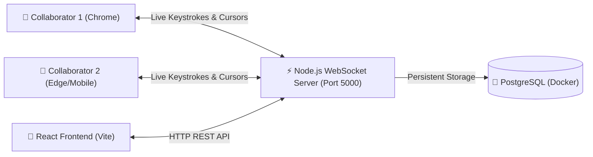

# DevPulse ⚡
### Real-Time Collaborative Document Workspace


**DevPulse** is a high-performance, real-time collaborative document platform inspired by Google Docs and Notion. It enables distributed teams and developers to brainstorm, document specifications, and edit notes concurrently with zero lag.

---

## ✨ Features

- ⚡ **Real-Time Concurrent Sync**: Bi-directional WebSocket communication broadcasting keystrokes instantly to all peers in the room.
- 👥 **Multi-User Presence**: Live collaborator avatars displaying custom initials, color codes, and online count.
- ✍️ **Live Typing Indicators**: Real-time *"User is typing..."* status banner when active peers edit the document.
- 🎨 **Personalized Profiles**: Interactive profile customizer allowing users to set custom display names and avatar colors.
- 💾 **Resilient State Persistence**: Auto-saves document drafts locally (`localStorage`) and across active server rooms.
- 🐳 **Containerized Database**: Pre-configured `docker-compose.yml` to spin up PostgreSQL 16 with zero setup friction.
- 🌙 **Modern Dark-Mode UI**: Built with Tailwind CSS and Lucide icons for a sleek, developer-focused aesthetic.

---

## 🏗️ System Architecture



---

## 🚀 Quick Start Guide

### Prerequisites
- [Node.js (LTS)](https://nodejs.org/) installed
- [Docker Desktop](https://www.docker.com/products/docker-desktop/) installed & running

### 1. Clone & Setup
```bash
git clone https://github.com/your-username/devpulse.git
cd devpulse
```

### 2. Start PostgreSQL Container
```bash
docker compose up -d
```

### 3. Start the Backend Server
```bash
cd server
npm install
npm run dev
```
*Server runs on `http://127.0.0.1:5000` with WebSockets on `ws://127.0.0.1:5000/ws/rooms/:docId`.*

### 4. Start the Frontend Client
In a second terminal:
```bash
cd client
npm install
npm run dev
```
*Client runs on `http://localhost:5173`.*

---

## 🧪 Testing Real-Time Sync
1. Open `http://localhost:5173` in Google Chrome.
2. Open the same link in a second browser window (or Incognito mode).
3. Change the collaborator name in Window 1 to your name.
4. Watch both windows reflect the active user count (`2 Online`), avatars, typing alerts, and real-time keystroke sync!

---

## 📜 License
MIT License. Created by Itish.
